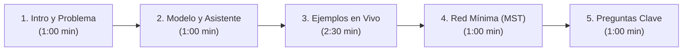

# Guion de Presentación: Módulo Guatemala (Transporte Express)

**Duración Estimada:** 5 a 7 minutos  
**Modalidad:** Un solo expositor  
**Herramienta:** RutaQ (https://criss-paz.github.io/rutaq/) en Modo Presentación  
**Expositor (por definir):** Cristopher Alexis Castellanos Paz / Leonel Taracena Marroquín / Pablo Alexander Vásquez Rivera  
**Universidad Mariano Gálvez de Guatemala — Facultad de Ingeniería en Sistemas**

---

## Estructura y Distribución del Tiempo

---

## 1. Introducción y Contexto del Problema (1:00 min)

> **[Paso en pantalla]:** Pantalla de inicio de RutaQ en modo _«Guatemala — Transporte Express»_ con el mapa de los 22 departamentos orientado al norte.

**Qué decir:**  
_«Buenos días catedrático y compañeros. Hoy les presentamos la solución al Proyecto II para la empresa **Transporte Express**, una compañía guatemalteca de logística que distribuye encomiendas a nivel nacional._

_El problema crítico que enfrentaba la empresa era que sus paquetes llegaban tarde a destino debido a la falta de planificación en sus rutas: los pilotos elegían caminos empíricos, desvíos innecesarios y no existía una red vial cuantificada con distancias reales._

_Para resolverlo, modelamos los 22 departamentos de la República como un grafo ponderado en nuestra plataforma **RutaQ**, donde cada nodo es la cabecera departamental oficial con coordenadas georreferenciadas reales, y cada arista es una carretera directa extraída de OpenStreetMap y OSRM con su kilometraje y nomenclatura oficial (como la CA-1, CA-9 o CA-13).»_

---

## 2. El Asistente de Transporte Express (1:00 min)

> **[Paso en pantalla]:** Mostrar el botón «Calcular mejor ruta» y el panel interactivo de dos preguntas.

**Qué decir:**  
_«El corazón de la solución para el despachador es un asistente que responde a dos preguntas operativas indispensables:_

1. _¿Dónde se encuentra el paquete?_
2. _¿A qué departamento debe entregarse?_

_Al seleccionar origen y destino, el sistema ejecuta el **Algoritmo de Dijkstra** sobre la red vial, encontrando en milisegundos la ruta matemáticamente óptima. No solo resalta el camino en el mapa, sino que entrega la hoja de ruta para el conductor: listado de nodos, desglose de tramos por carretera, kilometraje acumulado y la fórmula completa de la suma.»_

---

## 3. Demostración con Ejemplos en Vivo (2:30 min)

### Ejemplo 1: Quetzaltenango → Puerto Barrios (`QUE → IZA`)

> **[Paso en pantalla]:** Clic en el botón de ejemplo rápido «Quetzaltenango → Puerto Barrios» o seleccionar origen `QUE` y destino `IZA`.

**Qué decir:**  
_«Veamos nuestro primer caso: un envío transversal de costa a costa, desde el altiplano occidental en **Quetzaltenango (QUE)** hasta la costa del Caribe en **Puerto Barrios, Izabal (IZA)**._

_Observen cómo el algoritmo encuentra la ruta óptima sobre las carreteras entre departamentos vecinos con una distancia total de **494.0 km**. El camino transita desde Quetzaltenango por Totonicapán (28.8 km) y Quiché (36.2 km), enlaza directamente a través de Baja Verapaz (128.6 km) hacia Zacapa (128.3 km), conectando con la **CA-9 Norte** hasta Puerto Barrios (172.1 km), mostrando en pantalla cada tramo y eliminando cualquier desvío innecesario.»_

---

### Ejemplo 2: Ciudad de Guatemala → Flores, Petén (`GUA → PET`)

> **[Paso en pantalla]:** Clic en el botón «Ciudad de Guatemala → Flores» o seleccionar `GUA` a `PET`.

**Qué decir:**  
_«Nuestro segundo ejemplo conecta la sede central en **Ciudad de Guatemala (GUA)** con el destino más septentrional de la república: **Flores, Petén (PET)**._

_Petén se encuentra a una gran distancia hacia el norte. El sistema calcula una distancia total de **415.3 km**. Noten cómo el algoritmo avanza por la ruta norte conectando con Baja Verapaz (Salamá, 89.0 km), asciende hacia Alta Verapaz por la **CA-14** (69.0 km) y empalma directamente con Petén a través de la **Franja Transversal del Norte (RD PET-11 / RD AV-09, 257.3 km)**. El mapa proyectado en Web Mercator mantiene la orientación geográfica real norte-arriba, permitiendo hacer zoom fluido y ajustar la pantalla sin deformar la geografía nacional.»_

---

### Ejemplo 3: San Marcos → Jutiapa (`SMA → JUT`)

> **[Paso en pantalla]:** Clic en el botón «San Marcos → Jutiapa» o seleccionar `SMA` a `JUT`.

**Qué decir:**  
_«El tercer ejemplo une el extremo occidental fronterizo de **San Marcos (SMA)** con el oriente del país en **Jutiapa (JUT)**._

_Aquí el paquete recorre el país de oeste a este, cubriendo un trayecto óptimo de **368.3 km**. El desglose muestra el descenso desde el altiplano por San Marcos a Quetzaltenango (49.6 km) y hacia la costa sur en Suchitepéquez (60.2 km por CITO-180), conectando por Escuintla (102.5 km por CA-02 Occidente) y Santa Rosa (100.0 km) hasta la **CA-1 Oriente** en Jutiapa (56.0 km), permitiendo al despachador calcular con exactitud la hora estimada de llegada a la bodega receptora.»_

---

## 4. Red Mínima Nacional: Árbol de Expansión Mínima (1:00 min)

> **[Paso en pantalla]:** Abrir el selector de «Red Mínima Nacional (AEM / MST)» y alternar entre las pestañas de Prim y Kruskal.

**Qué decir:**  
_«Además de rutas punto a punto, Transporte Express necesitaba saber: ¿cuál es la infraestructura vial mínima necesaria para mantener comunicados los 22 departamentos de Guatemala con el menor kilometraje total?_

_Esto se modela con el **Árbol de Expansión Mínima (AEM)**. En RutaQ implementamos tanto el **Algoritmo de Prim** como el de **Kruskal**:_

- _Prim construye el árbol de forma expansiva a partir de un nodo raíz._
- _Kruskal ordena todas las aristas y las incorpora evitando ciclos mediante la estructura Union-Find._

_Ambos algoritmos arrojan exactamente la misma red óptima de 21 carreteras con un kilometraje total de **1 425.3 km**. Además, la interfaz presenta la solución tabulada paso a paso idéntica al método enseñado en clase, mostrando las aristas examinadas, los nodos incorporados y las aristas descartadas por formar ciclo.»_

---

## 5. Preguntas Probables del Catedrático y Respuestas Modelo

### Pregunta 1: ¿Por qué eligieron el Algoritmo de Dijkstra y no Bellman-Ford o Floyd-Warshall para la ruta del paquete?

**Respuesta:**  
_«Dijkstra es el algoritmo óptimo para caminos mínimos desde un origen único en grafos con pesos no negativos. Como las distancias viales son siempre positivas ($W(e) > 0$), Dijkstra resuelve la consulta en tiempo $O((V+E) \log V)$ usando un min-heap, lo cual es instantáneo en el navegador. Bellman-Ford sería innecesario porque fue diseñado para detectar ciclos negativos que no existen en distancias físicas, y Floyd-Warshall calcula todos los pares con complejidad cúbica $O(V^3)$, lo cual reservamos en un Web Worker en segundo plano para análisis globales, pero no para la consulta puntual del usuario.»_

---

### Pregunta 2: ¿Qué sucedería si en este problema tuviéramos pesos negativos?

**Respuesta:**  
_«En una red vial real, una distancia física negativa es imposible. Sin embargo, en un problema abstracto de logística con costos compensatorios (por ejemplo, subsidios o bonificaciones por tramo), si existieran pesos negativos el algoritmo de Dijkstra fallaría, ya que asume que una vez que un nodo se vuelve permanente su distancia es definitiva. En tal caso, tendríamos que utilizar el algoritmo de **Bellman-Ford**, que relaja todas las aristas $|V|-1$ veces y detecta si existen ciclos de costo negativo.»_

---

### Pregunta 3: ¿Cuál es la diferencia conceptual entre la "Ruta Más Corta" y el "Árbol de Expansión Mínima (AEM)"?

**Respuesta:**  
_«La **Ruta Más Corta** (Dijkstra) optimiza la distancia entre un par específico de nodos (origen y destino) o las distancias radiales individuales desde un nodo hacia los demás. Por el contrario, el **AEM** (Prim/Kruskal) optimiza el costo global de la red completa: busca conectar todos los 22 departamentos entre sí minimizando la suma total de las carreteras utilizadas, sin ciclos. Un camino dentro del AEM no siempre es la ruta más corta entre dos puntos, pero el AEM garantiza que toda la nación queda comunicada con el menor kilometraje total de asfalto.»_

---

## 6. Cierre de la Presentación (0:30 min)

**Qué decir:**  
_«En conclusión, RutaQ transforma una operación logística empírica en una herramienta científica y auditable. Cumple con los requerimientos del curso: datos reales de los 22 departamentos, formulación matemática exacta, interfaz intuitiva y código modular 100 % TypeScript. Muchas gracias y quedamos a su disposición para cualquier prueba en vivo adicional.»_
