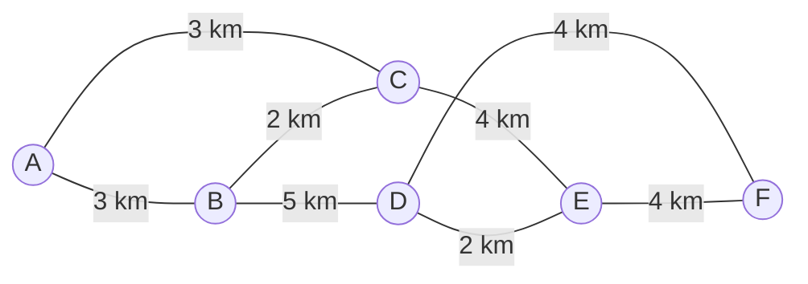

# Solución Teórica a Mano: Árbol de Expansión Mínima (AEM / MST)

**Proyecto II — Transporte Express (RutaQ)**  
**Universidad Mariano Gálvez de Guatemala**  
**Facultad de Ingeniería en Sistemas de Información**  
**Autores:**

- Cristopher Alexis Castellanos Paz (Carné: 2690-24-5972)
- Leonel Taracena Marroquín (Carné: 2690-24-4072)
- Pablo Alexander Vásquez Rivera (Carné: 2690-24-13123)

---

## 1. Definición del Grafo Académico de 6 Nodos

Para ilustrar de forma rigurosa y manual la construcción del **Árbol de Expansión Mínima (AEM / MST)** según los métodos expuestos en clase, se define un grafo no dirigido conexo ponderado $G = (V, E)$ de $|V| = 6$ vértices y $|E| = 8$ aristas, contenido formalmente en [`src/data/ejemplo_mst.json`](file:///C:/Users/DELL/orca/workspaces/Ruta%20Mas%20Corta/gemini-data/src/data/ejemplo_mst.json):

- **Conjunto de vértices:** $V = \{A, B, C, D, E, F\}$
- **Unidad de medida:** Kilómetros ($\text{km}$)
- **Conjunto de aristas con pesos:**
  1. $A\text{–}B$: $3\text{ km}$
  2. $A\text{–}C$: $3\text{ km}$
  3. $B\text{–}C$: $2\text{ km}$
  4. $B\text{–}D$: $5\text{ km}$
  5. $C\text{–}E$: $4\text{ km}$
  6. $D\text{–}E$: $2\text{ km}$
  7. $D\text{–}F$: $4\text{ km}$
  8. $E\text{–}F$: $4\text{ km}$



### Regla Determinista de Desempate

Ante aristas con **igual peso ponderado**, el sistema y la resolución manual aplican el criterio determinista de desempate por orden alfabético estricto de identificador (`id_a < id_b`, sin locale). Por ejemplo:

- Entre $A\text{–}B$ ($3\text{ km}$) y $A\text{–}C$ ($3\text{ km}$), gana **$A\text{–}B$**.
- Entre $D\text{–}F$ ($4\text{ km}$) y $E\text{–}F$ ($4\text{ km}$), gana **$D\text{–}F$**.

Todo árbol de expansión para un grafo de $|V| = 6$ nodos debe contener exactamente $|V| - 1 = 5$ aristas y carecer de ciclos.

---

## 2. Solución Manual Paso a Paso: Algoritmo de Prim

El algoritmo de Prim hace crecer un único árbol componente conexa $V_T$ a partir de un nodo inicial arbitrario ($s = A$). En cada iteración $k$, examina el corte $(V_T, V \setminus V_T)$ y selecciona la arista de menor peso que conecta un vértice ya incorporado con uno exterior.

### Inicialización:

- Nodo inicial: $A$
- Vértices en el árbol: $V_T = \{A\}$
- Vértices restantes: $V \setminus V_T = \{B, C, D, E, F\}$
- Aristas seleccionadas: $E_T = \emptyset$
- Peso acumulado: $W = 0\text{ km}$

### Tabla de Iteraciones del Algoritmo de Prim (desde $A$)

| Paso ($k$) | Vértices en el Árbol ($V_T$) | Aristas del Corte Evaluadas                                   |     Arista Mínima Elegida      | Peso ($\text{km}$) | Nodo Incorporado | Columna Tachada | Peso Acumulado ($W$) |
| :--------: | :--------------------------- | :------------------------------------------------------------ | :----------------------------: | :----------------: | :--------------: | :-------------: | :------------------: |
|   **0**    | $\{A\}$                      | —                                                             |               —                |         —          |       $A$        |       $A$       |    $0\text{ km}$     |
|   **1**    | $\{A\}$                      | $A\text{–}B$ (3), $A\text{–}C$ (3)                            | **$A\text{–}B$** _(desempate)_ |        $3$         |       $B$        |       $B$       |    $3\text{ km}$     |
|   **2**    | $\{A, B\}$                   | $B\text{–}C$ (2), $A\text{–}C$ (3), $B\text{–}D$ (5)          |        **$B\text{–}C$**        |        $2$         |       $C$        |       $C$       |    $5\text{ km}$     |
|   **3**    | $\{A, B, C\}$                | $C\text{–}E$ (4), $B\text{–}D$ (5)                            |        **$C\text{–}E$**        |        $4$         |       $E$        |       $E$       |    $9\text{ km}$     |
|   **4**    | $\{A, B, C, E\}$             | $D\text{–}E$ (2), $E\text{–}F$ (4), $B\text{–}D$ (5)          |        **$D\text{–}E$**        |        $2$         |       $D$        |       $D$       |    $11\text{ km}$    |
|   **5**    | $\{A, B, C, D, E\}$          | $D\text{–}F$ (4), $E\text{–}F$ (4), $B\text{–}D$ (ciclo int.) | **$D\text{–}F$** _(desempate)_ |        $4$         |       $F$        |       $F$       |  **$15\text{ km}$**  |

### Análisis de Decisiones en Prim:

1. **Paso 1:** Empate entre $A\text{–}B$ ($3\text{ km}$) y $A\text{–}C$ ($3\text{ km}$). Se aplica la regla lexicográfica: `"A-B" < "A-C"`, incorporando $B$.
2. **Paso 2:** La arista $B\text{–}C$ tiene peso $2$, inferior a $A\text{–}C$ ($3$) y $B\text{–}D$ ($5$). Se incorpora $C$.
3. **Paso 3:** La arista $A\text{–}C$ ya no cruza el corte (ambos extremos en $V_T$). Las aristas que cruzan hacia afuera son $C\text{–}E$ ($4$) y $B\text{–}D$ ($5$). La mínima es $C\text{–}E$, incorporando $E$.
4. **Paso 4:** Desde $E$ surge la conexión $D\text{–}E$ de peso $2$, menor que $E\text{–}F$ ($4$) y $B\text{–}D$ ($5$). Se incorpora $D$.
5. **Paso 5:** Resta únicamente el nodo $F$. Las opciones son $D\text{–}F$ ($4$) y $E\text{–}F$ ($4$). Empate en peso: por desempate `"D-F" < "E-F"` se elige $D\text{–}F$.

**Aristas del AEM seleccionadas por Prim:**  
$\{A\text{–}B, B\text{–}C, C\text{–}E, D\text{–}E, D\text{–}F\}$  
**Peso total de Prim:** $3 + 2 + 4 + 2 + 4 = \mathbf{15\text{ km}}$.

---

## 3. Solución Manual Paso a Paso: Algoritmo de Kruskal

El algoritmo de Kruskal ordena inicialmente **todas las aristas del grafo de menor a mayor peso** y las evalúa secuencialmente. Si los extremos de la arista pertenecen a componentes conexas disjuntas, la arista es **aceptada** y se fusionan sus componentes; si ambos extremos ya están en la misma componente, la arista es **rechazada** porque formaría un ciclo.

### Lista Global de Aristas Ordenadas por Peso (con Desempate):

| Posición |   Arista ($e$)   | Peso ($\text{km}$) | Justificación de Orden             |
| :------: | :--------------: | :----------------: | :--------------------------------- |
|    1     | **$B\text{–}C$** |        $2$         | Peso menor ($2$) · `"B-C" < "D-E"` |
|    2     | **$D\text{–}E$** |        $2$         | Peso menor ($2$)                   |
|    3     | **$A\text{–}B$** |        $3$         | Peso $3$ · `"A-B" < "A-C"`         |
|    4     | **$A\text{–}C$** |        $3$         | Peso $3$                           |
|    5     | **$C\text{–}E$** |        $4$         | Peso $4$ · `"C-E" < "D-F" < "E-F"` |
|    6     | **$D\text{–}F$** |        $4$         | Peso $4$ · `"D-F" < "E-F"`         |
|    7     | **$E\text{–}F$** |        $4$         | Peso $4$                           |
|    8     | **$B\text{–}D$** |        $5$         | Peso mayor ($5$)                   |

### Tabla de Ejecución del Algoritmo de Kruskal

| Paso ($k$) | Arista Evaluada | Peso ($\text{km}$) | Componentes de los Extremos              |   Decisión    | Motivo / Diagnóstico de Ciclo                                     | Bosque Resultante (Partición de $V$)       |  Total Acumulado   |
| :--------: | :-------------: | :----------------: | :--------------------------------------- | :-----------: | :---------------------------------------------------------------- | :----------------------------------------- | :----------------: |
|   **0**    |        —        |         —          | —                                        |       —       | Inicialización (6 componentes)                                    | $\{A\}, \{B\}, \{C\}, \{D\}, \{E\}, \{F\}$ |   $0\text{ km}$    |
|   **1**    |  $B\text{–}C$   |        $2$         | $B \in \{B\}$, $C \in \{C\}$             | **ACEPTADA**  | Componentes disjuntas                                             | $\{A\}, \{B, C\}, \{D\}, \{E\}, \{F\}$     |   $2\text{ km}$    |
|   **2**    |  $D\text{–}E$   |        $2$         | $D \in \{D\}$, $E \in \{E\}$             | **ACEPTADA**  | Componentes disjuntas                                             | $\{A\}, \{B, C\}, \{D, E\}, \{F\}$         |   $4\text{ km}$    |
|   **3**    |  $A\text{–}B$   |        $3$         | $A \in \{A\}$, $B \in \{B, C\}$          | **ACEPTADA**  | Componentes disjuntas                                             | $\{A, B, C\}, \{D, E\}, \{F\}$             |   $7\text{ km}$    |
|   **4**    |  $A\text{–}C$   |        $3$         | $A \in \{A, B, C\}$, $C \in \{A, B, C\}$ | **RECHAZADA** | **Formaría el ciclo $A\text{–}B\text{–}C\text{–}A$**              | $\{A, B, C\}, \{D, E\}, \{F\}$             |   $7\text{ km}$    |
|   **5**    |  $C\text{–}E$   |        $4$         | $C \in \{A, B, C\}$, $E \in \{D, E\}$    | **ACEPTADA**  | Conecta las dos componentes mayores                               | $\{A, B, C, D, E\}, \{F\}$                 |   $11\text{ km}$   |
|   **6**    |  $D\text{–}F$   |        $4$         | $D \in \{A, B, C, D, E\}$, $F \in \{F\}$ | **ACEPTADA**  | Incorpora el último nodo aislado ($F$)                            | $\{A, B, C, D, E, F\}$                     | **$15\text{ km}$** |
|     —      |  $E\text{–}F$   |        $4$         | Ambos en $\{A, B, C, D, E, F\}$          |   _Omitida_   | Formaría ciclo $D\text{–}E\text{–}F\text{–}D$ (árbol ya completo) | $\{A, B, C, D, E, F\}$                     |   $15\text{ km}$   |
|     —      |  $B\text{–}D$   |        $5$         | Ambos en $\{A, B, C, D, E, F\}$          |   _Omitida_   | Formaría ciclo $B\text{–}C\text{–}E\text{–}D\text{–}B$            | $\{A, B, C, D, E, F\}$                     |   $15\text{ km}$   |

### Análisis de la Arista Rechazada:

- En la iteración **4**, la arista $A\text{–}C$ ($3\text{ km}$) une los vértices $A$ y $C$. Como $A\text{–}B$ y $B\text{–}C$ ya habían sido aceptadas previamente en los pasos 1 y 3, los vértices $A$ y $C$ pertenecen a la misma componente conexa $\{A, B, C\}$. Añadir $A\text{–}C$ cerraría de forma redundante el ciclo simple $(A, B, C, A)$. Por tanto, el algoritmo la descarta formalmente sin incrementar el costo acumulado.

**Aristas del AEM seleccionadas por Kruskal:**  
$\{B\text{–}C, D\text{–}E, A\text{–}B, C\text{–}E, D\text{–}F\}$  
**Peso total de Kruskal:** $2 + 2 + 3 + 4 + 4 = \mathbf{15\text{ km}}$.

---

## 4. Comparación Cruzada y Conclusiones

| Propiedad                       |                 Algoritmo de Prim (inicio: $A$)                  |                       Algoritmo de Kruskal                       |     Coincidencia     |
| :------------------------------ | :--------------------------------------------------------------: | :--------------------------------------------------------------: | :------------------: |
| **Número de aristas**           |                               $5$                                |                               $5$                                |      Exacta ($       | V   | -1$) |
| **Conjunto de aristas**         | $\{A\text{–}B, B\text{–}C, C\text{–}E, D\text{–}E, D\text{–}F\}$ | $\{B\text{–}C, D\text{–}E, A\text{–}B, C\text{–}E, D\text{–}F\}$ |     **Idéntico**     |
| **Aristas de desempate**        |           $A\text{–}B$ (paso 1), $D\text{–}F$ (paso 5)           |           $B\text{–}C$ (paso 1), $A\text{–}B$ (paso 3)           |      Coherente       |
| **Arista rechazada por ciclo**  |                Excluida del corte implícitamente                 |           **$A\text{–}C$** (rechazo explícito paso 4)            | Conforme a la teoría |
| **Peso total de la red mínima** |                       **$15.0\text{ km}$**                       |                       **$15.0\text{ km}$**                       |  **100 % idéntico**  |

### Visualización del Árbol de Expansión Mínima Resultante

```mermaid
graph LR
    A((A)) ===|3 km| B((B))
    B((B)) ===|2 km| C((C))
    C((C)) ===|4 km| E((E))
    E((E)) ===|2 km| D((D))
    D((D)) ===|4 km| F((F))

    A -.->|3 km (rechazada ciclo)| C
    B -.->|5 km (no elegida)| D
    E -.->|4 km (no elegida)| F

    style A fill:#e0f2fe,stroke:#0369a1,stroke-width:2px
    style B fill:#e0f2fe,stroke:#0369a1,stroke-width:2px
    style C fill:#e0f2fe,stroke:#0369a1,stroke-width:2px
    style D fill:#e0f2fe,stroke:#0369a1,stroke-width:2px
    style E fill:#e0f2fe,stroke:#0369a1,stroke-width:2px
    style F fill:#e0f2fe,stroke:#0369a1,stroke-width:2px
```

La solución manual valida exactamente la implementación computacional en `src/core/mst.ts`, cumpliendo con todos los criterios de paridad, desempate y prevención de ciclos exigidos para el Proyecto II.
